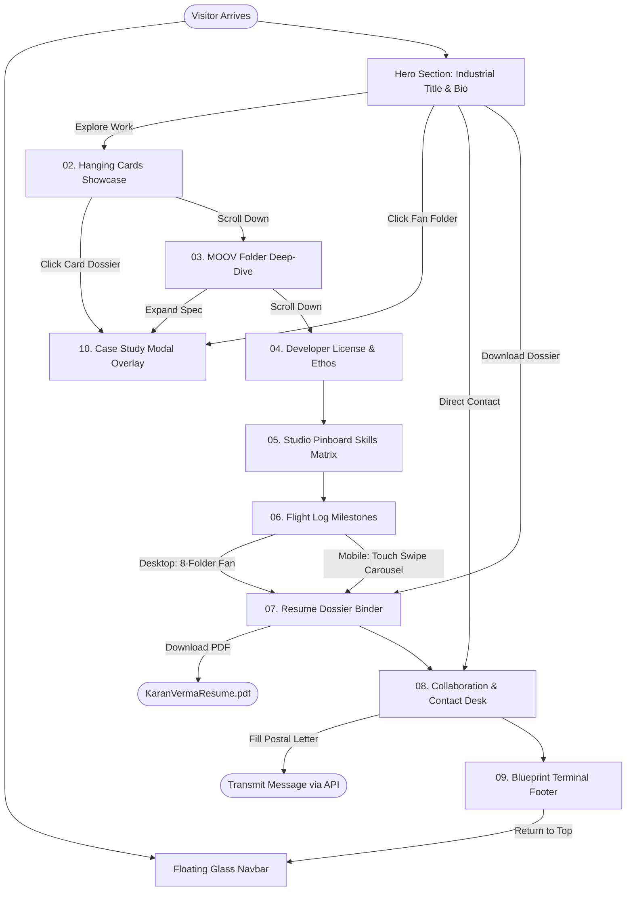

# Karan Verma Portfolio — Complete UI Wireframe & Architecture Blueprint

This specification details the comprehensive UI design, layout wireframes, interactive mechanics, and responsive architecture of the currently hosted **Karan Verma Personal Developer Portfolio** (React 19 + TypeScript + Vite + Tailwind CSS).

---

## 🛠️ Free Developer Tools & Editable Files

All wireframe models have been generated and placed directly in the **`Portfolio/`** directory:

| File Name | Format | Primary Tool / Editor | Purpose |
| :--- | :--- | :--- | :--- |
| **[`wireframe.excalidraw`](./wireframe.excalidraw)** | Excalidraw JSON v2 | [Excalidraw.com](https://excalidraw.com) (Free web app) or VS Code Excalidraw extension | **Proper Editable Wireframe Diagram Model**: 714 interactive vector elements (rectangles, labels, connectors, pills, cards). Fully drag-and-drop editable. |
| **[`wireframe.svg`](./wireframe.svg)** | Vector SVG (2860x6480) | Any Browser, Figma, Penpot, Inkscape, Illustrator | High-resolution scalable vector graphic of all viewports and design tokens. |
| **[`wireframe.html`](./wireframe.html)** | Standalone HTML5 Application | Chrome / Safari / Edge / Firefox | Interactive browser preview with device viewport switching (Desktop, Mobile, Modal, Tokens) and zoom/pan tools. |
| **[`WIREFRAME_SPEC.md`](./WIREFRAME_SPEC.md)** | Markdown Document | Markdown reader / GitHub / IDE | Architectural layout specification, responsive matrices, and interaction flows. |

### How to Open & Edit in Free Web Tools:
1. **Via Excalidraw Web App (100% Free, No Login Required)**:
   - Navigate to [https://excalidraw.com](https://excalidraw.com) in any browser.
   - Click the **Hamburger Menu (≡)** in the top-left corner.
   - Click **Open** (or press `Ctrl+O` / `Cmd+O`).
   - Select the file **`Portfolio/wireframe.excalidraw`**.
   - You can now freely move cards, edit typography, adjust dimensions, and export as PNG/SVG.
2. **Via Visual Studio Code**:
   - Install the free **Excalidraw** extension by `pomdtr` from the VS Code Marketplace.
   - Click on `wireframe.excalidraw` in the file tree. It will render natively inside your editor with real-time vector tools.
3. **Via Browser Preview**:
   - Double-click or open `Portfolio/wireframe.html` in your browser to inspect sections, toggle viewports, and jump between breakpoints.

---

## 📐 Layout Architecture & Viewport Map

The wireframe model documents three complete viewport projections and an architectural design system:

```
┌────────────────────────────────────────────────────────────────────────────────────────┐
│  PROJECT TITLE BLOCK & RUNTIME METADATA (X: 100, Y: 30, Width: 2660px)                 │
└────────────────────────────────────────────────────────────────────────────────────────┘
┌──────────────────────────┐  ┌────────────────┐  ┌────────────────────────────────────┐
│ VIEWPORT 1: DESKTOP      │  │ VIEWPORT 2:    │  │ VIEWPORT 3: CASE STUDY MODAL       │
│ 1280px × 5600px          │  │ MOBILE 390px   │  │ 860px × 980px                      │
│                          │  │                │  │                                    │
│ 00. Floating Glass Pill  │  │ 00. Mobile Bar │  │ • Frosted Dark Backdrop            │
│ 01. Hero & Folder Fan    │  │ 01. Hero Stack │  │ • Sticky Header [ESC / ✕]          │
│ 02. Hanging Showcase     │  │ 02. Touch Feed │  │ • Official Credential Seal         │
│ 03. MOOV Folder Deep-Dive│  │ 03. Telemetry  │  │ • 4 Live Telemetry Metrics         │
│ 04. Developer License    │  │ 04. Badge View │  │ • Problem Statement vs Solution    │
│ 05. Studio Pinboard      │  │ 05. 2-Col Grid │  │ • Architecture Tech Matrix         │
│ 06. Flight Log Passes    │  │ 06. Touch-Swipe│  │ • 4-Contributor Team Roster        │
│ 07. Resume Binder Dossier│  │ 07. Dossier    │  │ • Live Demo & GitHub Action Bar    │
│ 08. Stationery Desk      │  │ 08. Contact    │  └────────────────────────────────────┘
│ 09. Terminal Footprint   │  │ 09. Footer     │
└──────────────────────────┘  └────────────────┘
┌────────────────────────────────────────────────────────────────────────────────────────┐
│ VIEWPORT 4: DESIGN SYSTEM TOKENS & RESPONSIVE BREAKPOINT SPEC (X: 100, Y: 5780)        │
│ • Color Palette (Canvas #0B0F17, Slate #1E293B, Accent #F97316, Cyan #06B6D4)          │
│ • Typography Scale (Display 38px, Title 26px, Card 16px, Body 14px, Code 11px)         │
│ • Breakpoint Matrix (Mobile <640px, Tablet 640-1024px, Desktop >1024px)               │
└────────────────────────────────────────────────────────────────────────────────────────┘
```

---

## 🧩 Detailed Component Specifications

### 00. Top Floating Navbar (`Navbar.tsx`)
- **Structure**: Floating Apple-style glass pill (`backdrop-blur-md`), fixed at `top: 1.5rem`.
- **Elements**:
  - Brand identity pill: `⚡ KV // KARAN VERMA`
  - Smooth anchor navigation: `Home`, `Work`, `Deep-Dive`, `About`, `Stack`, `Journey`, `Resume`, `Contact`
  - Theme Toggle: Interactive Day (`☀️`) / Night (`🌙`) mode with persistent `localStorage` state.
  - Call to Action: `Let's Talk →` button with hover glow.
- **Mobile Variant**: Streamlined 50px pill with KV badge, theme icon, and hamburger modal trigger.

### 01. Hero Section (`Hero.tsx` + `FrostedFolderFan.tsx`)
- **Availability Pill**: `🟢 Open for Full-Stack & System Design roles`
- **Display Typography**: *"Architecting Resilient Web Systems & Industrial Grade Interfaces."*
- **Credentials Summary**:
  - B.Tech in Computer Science & Engineering (8.82 CGPA, Medi-Caps University)
  - Winner of Ministry of MSME Idea Hackathon 3.0 (₹15 Lakh Govt Grant)
- **Call-to-Action Group**: `[Explore Work ↓]` (primary), `[Direct Contact →]`, `[Download Dossier PDF]`.
- **Frosted Folder Fan**: 3 interactive physical folder cards arranged in an overlapping fan:
  - Card 1 (-12° tilt): MOOV Logistics (42K Trips, 140ms Latency)
  - Card 2 (0° tilt): GovDocs Decentralized Vault (Ethereum + IPFS)
  - Card 3 (+12° tilt): SwaasthySetu Telemedicine (WebRTC audio/video)

### 02. Hanging Cards Showcase (`HangingCardsShowcase.tsx`)
- **Visual Metaphor**: Overhead steel suspension cable with metallic binder clips/clothespins.
- **Physics**: Subtle alternating tilt angles (-2°, +2°) with mouse scroll tilt reactions.
- **Card Contents**:
  - `MOOV Logistics`: Real-time vehicle telemetry hub (React 19, TypeScript, Node, WebSockets).
  - `GovDocs Vault`: Decentralized credential verification (Solidity, IPFS, Ethers.js).
  - `SwaasthySetu`: Low-bandwidth rural telemedicine diagnostic suite (WebRTC, Node, MongoDB).
  - `AI Code Auditor`: AST-based vulnerability analyzer (Python, AST parser, FastAPI).
- **Actions**: `[View Full Case Study →]` triggers modal; `[Live App ↗]` and `[GitHub ↗]` direct links.

### 03. MOOV Large Floating Folder Deep-Dive (`MoovFolderDeepDive.tsx`)
- **Physical Manila Tab**: Serialized label `📁 DOSSIER // PRJ-01: HIGH CONCURRENCY LOGISTICS`.
- **Split Screen Layout**:
  - **Left Pane (Live Telemetry)**:
    - `99.98%` Production SLA (Zero unhandled failovers)
    - `140ms` p95 Dispatch Latency (WebSocket pipeline)
    - `42,850` Active Concurrent Fleet Trips (Redis spatial index)
    - `12.4k` Telemetry Requests/sec (Distributed Go/Node gateway)
  - **Right Pane (Architectural Blueprints)**:
    - Layer 1: Client State (React 19 Concurrent + Leaflet Spatial Clusters)
    - Layer 2: API Gateway (Express + Socket.io + JWT Cluster)
    - Layer 3: Cache & Stream (Redis Geo-spatial Pub/Sub)
    - Layer 4: Storage Layer (PostgreSQL with PostGIS extensions)
  - **Credentials**: Explicit attribution to team contributors: Sneha Patidar, Sneha Sharma, Sourav Chaudhary, Karan Verma.

### 04. About & Operating Philosophy (`AboutSection.tsx` + `DeveloperLicenseBadge.tsx`)
- **Left Column: Developer License Card**:
  - Official Code Republic badge with photo box, License ID `#KV-2026-ENG-882`.
  - Degree: B.Tech Computer Science & Engineering (8.82 CGPA, Medi-Caps University).
  - Security Hologram Seal with MSME 3.0 stamp.
  - Machine-readable QR Code verification module.
- **Right Column: 4 Operating Philosophy Pillars**:
  1. *System Reliability First*: Fail gracefully, circuit breakers, zero downtime.
  2. *High-Performance Frontends*: Sub-100ms TTI, 60fps interaction budgets.
  3. *Distributed Architecture*: Decoupled services communicating over structured event streams.
  4. *Human-Centered DX*: Strict end-to-end typing, reproducible containers.
- **Govt of India MSME Grant**: Dedicated feature card highlighting the ₹15 Lakh award.

### 05. Technical Arsenal Studio Pinboard (`SkillsSection.tsx`)
- **Visual Metaphor**: Studio corkboard wall with 4 wooden/brass pushpins.
- **4 Categorized Sticky Matrix Boards**:
  - *Frontend Engineering*: React 19, TypeScript, Next.js, Tailwind CSS, Redux Toolkit, Framer Motion.
  - *Backend & Distributed*: Node.js, Express, Go, Python, WebSockets, REST & GraphQL, gRPC.
  - *Databases & Caching*: PostgreSQL, PostGIS, MongoDB, Redis, Prisma ORM, ACID transactions.
  - *DevOps, Cloud & Tooling*: Docker, Git/GitHub Actions, AWS (S3, EC2), Linux, Vite.

### 06. Flight Log & Journey Milestones (`JourneySection.tsx`)
- **Desktop**: Fan of 8 chronological boarding passes / milestone folders:
  - 2024: MSME Idea Hackathon 3.0 National Winner (₹15 Lakh Grant)
  - 2024: B.Tech CSE Graduation (8.82 CGPA, Medi-Caps University)
  - 2024: MOOV Logistics Engine Launch
  - 2023: GovDocs Decentralized Vault Launch
  - 2023: SwaasthySetu Telemedicine Platform
  - 2023: Technical Leadership & Student Club Lead
  - 2022: Full-Stack Engineering Certifications
  - 2026: Present Systems Engineering & Distributed Research
- **Mobile**: Touch-swipe carousel with swipe gesture feedback, active card indicators, and dot pagination.

### 07. Official Resume Dossier (`ResumeSection.tsx`)
- **Physical Metaphor**: Archival Manilla binder with brass eyelets and perforated document sheets.
- **Top Row**: Identification pass + Pop Art sticker (*"STRICTLY SYSTEM ARCHITECTURE"*).
- **Middle Row**: Perforated experience & education record with clear role bullet points.
- **Bottom Row**: Official PDF trigger button (*"Download Official PDF [📄]"*) and ATS-compliant validation badge.

### 08. Collaboration & Contact Desk (`ContactSection.tsx`)
- **Desk Stationery Metaphor**:
  - **Live World Clock**: Real-time IST (UTC+5:30) station clock indicating active working hours in Indore, India.
  - **Direct Channels**: Email, Telegram, LinkedIn, GitHub, and location coordinates.
  - **Postal Letter Transmitter**:
    - Air Mail postage stamp & postmark graphics.
    - Fields: Sender Name, Email, Project Brief, Budget/Timeline.
    - Submit trigger: Wax seal stamp button (*"Seal & Dispatch Message [✉️]"*).

### 09. System Blueprint Footer (`Footer.tsx`)
- Terminal console prompt: `kv@portfolio ~ % status: 200 OK | SLA: 99.98%`.
- Build stack indicators: React 19, TypeScript, Vite, Tailwind CSS.
- Copyright attribution & smooth scroll "Return to Top" button.

### 10. Interactive Case Study Modal Overlay (`CaseStudyModal.tsx`)
- Full-screen glassmorphic overlay triggered by any "View Case Study" action.
- Sticky header with project code, status pill, and keyboard ESC / close button.
- Official Project Specimen banner with gold hologram stamp.
- Problem Statement vs Architectural Solution dual-column breakdown.
- 4 Live telemetry stat boxes (Uptime, Latency, Concurrency, Ingestion).
- Complete Architectural Tech Stack matrix.
- Team Attribution Roster listing Sneha Patidar, Sneha Sharma, Sourav Chaudhary, and Karan Verma.
- Action Bar: Direct links to launch the live application and inspect the GitHub repository.

---

## 🔄 Interaction & User Flow Diagram



---

## 🎨 Design System Tokens

| Category | Token Name | Value | Usage |
| :--- | :--- | :--- | :--- |
| **Colors** | `bg-canvas` | `#0b0f17` (dark) / `#f8fafc` (light) | Main viewport backdrop |
| | `surface-card` | `#1e293b` (dark) / `#ffffff` (light) | Container surfaces and modal windows |
| | `border-slate` | `#334155` (dark) / `#cbd5e1` (light) | Structural borders & separators |
| | `accent-orange` | `#ea580c` / `#f97316` | Primary CTA buttons & highlight badges |
| | `accent-cyan` | `#0284c7` / `#38bdf8` | Links, active states & technical labels |
| | `status-green` | `#059669` / `#10b981` | SLA indicators & live status tags |
| **Typography**| `font-sans` | System UI, Inter, -apple-system | Body text, titles, navigation |
| | `font-mono` | SFMono, Menlo, Consolas, monospace | SLAs, coordinates, code tags, badge IDs |
| **Breakpoints** | Mobile | `< 640px` | Single column stacked, touch carousel |
| | Tablet | `640px - 1024px` | 2-column grid, compact drawer tabs |
| | Desktop | `> 1024px` | 1280px max-width, 3D folder fan, suspension cable |

---

*Verified and synchronized with the live portfolio codebase on localhost:3000.*
